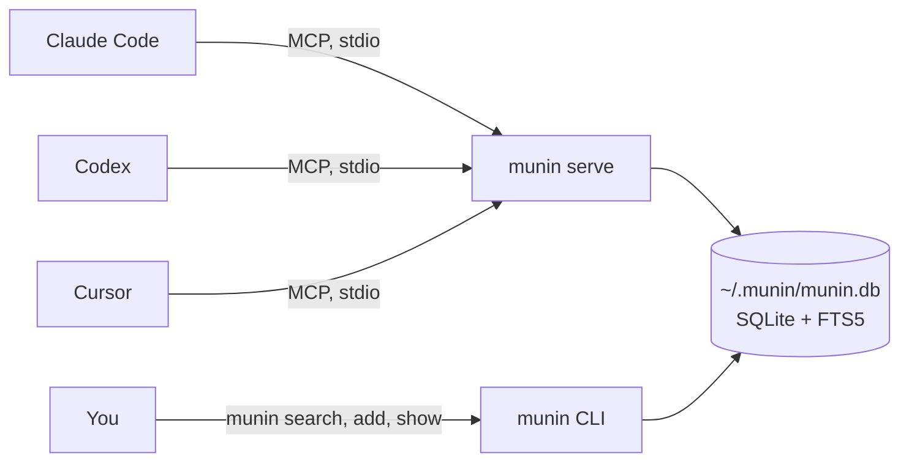
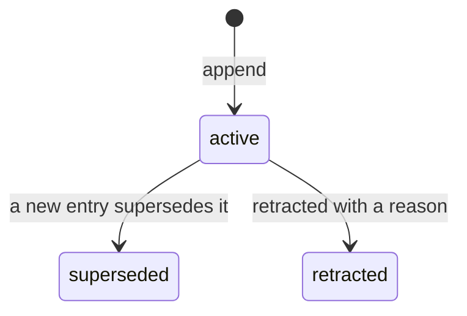

Munin is local memory for AI coding agents. An agent searches it before
unfamiliar work and records what it learned afterwards: decisions, how the
system is built, bugs and their fixes. Everything lives in one SQLite file on
your machine, and every MCP client on it shares the same memory.

## What it gives

- **Agents start from what earlier sessions learned.** A search returns
  compact cards; the full entry is read only when a card looks relevant, so
  looking costs few tokens.
- **Old fixes fade, decisions stay.** `bugfix` and `note` entries lose half
  their weight every 30 days; `decision` and `architecture` never do. Age is
  applied to every match before the limit, so one old decision is not pushed
  out by a pile of stale fixes.
- **Nothing is overwritten.** A new entry supersedes an outdated one and the
  chain is visible from both ends; a wrong entry is retracted with a reason.
  The database itself refuses edits and deletes.
- **One project, or a whole system.** Memory is scoped to the project the
  agent works in. Projects can be grouped, for example the services of one
  microservice system: a project in a group searches the whole group, and
  decisions that span services are recorded on the group.
- **Errors an agent can act on.** Bad input is rejected with the field and
  what is allowed, never silently turned into something else.
- **Local by construction.** One binary and one file. No network access, no
  telemetry, nothing running in the background.

## How it works

Agents reach Munin through MCP; people use the same binary from the shell.
Both work on one database file.



An entry is never edited. It stays active until a newer entry replaces it or
someone marks it wrong; either way it remains readable with its history.



## Quick start

There is no release yet, so build from source:

```bash
git clone https://github.com/alnovis/munin.git
cd munin
cargo install --locked --path .
claude mcp add --scope user munin -- munin serve
```

Then work as usual; the agent receives its instructions from Munin on
connect. To see what it has recorded:

```bash
munin search <words>
munin show <id>
```

## Documentation

| Document | What it covers |
|----------|----------------|
| [Install](docs/INSTALL.md) | Release archives, building from source, connecting Claude Code, Codex, Cursor and OpenCode |
| [Usage](docs/USAGE.md) | Entries and kinds, search, superseding, groups, command line, configuration, backups |
| [Specification](docs/SPEC.md) | Data model, ranking, tools and the decisions behind them |
| [Development](docs/DEVELOPMENT.md) | Checks, branches, CI |
| [Releasing](docs/RELEASING.md) | What a version number promises, how a release is cut |

## Acknowledgements

Munin reimplements the ideas of
[larchanka/memo-mcp](https://github.com/larchanka/memo-mcp) in Rust: the single
SQLite file, two-stage retrieval, typed time decay and the shared tag
vocabulary come from there.

## License

MIT
